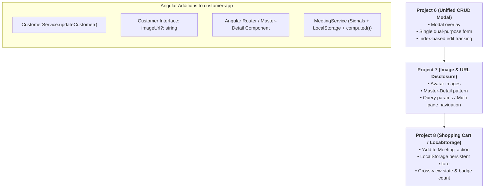

# Architectural Roadmap: Transforming Projects 6, 7, and 8 into Modern Angular

This document outlines the architectural plan for converting the remaining Vanilla JavaScript projects (**`p6`**, **`p7`**, and **`p8`**) into strictly-typed, reactive components within the **`customer-app`** Angular project.

---

## High-Level Progression

---

## 1. Project 6: Unified CRUD Experience (`p6/app6.html` & `app6.js`)

### Vanilla JS Behavior
* Combines the separate "Add" form and "Edit" modal from `p5` into a **single, unified modal dialog**.
* Toggles between **Add Mode** (`currentEditIndex === null`) and **Edit Mode** (`currentEditIndex !== null`).
* Directly manipulates the DOM via `document.getElementById('customerModal').style.display = 'flex' / 'none'`.
* Saves by either appending (`customers.push(...)`) or overwriting (`customers[currentEditIndex] = ...`).

### Angular Implementation
1. **Service Enhancement**:
   * Add `updateCustomer(index: number, updatedCustomer: Customer): void` to `CustomerService` using immutable Signal updates (`this.customerData.update(...)`).
2. **New Component: `P6CrudModal` (`src/app/p6-crud/`)**:
   * **State**:
     * `isModalOpen = signal(false)` (replaces manual `style.display = 'flex'/'none'`).
     * `currentEditIndex: number | null = null`.
     * `formData: Customer = this.createEmptyCustomer()`.
   * **Template**:
     * Uses Angular **`@if (isModalOpen())`** to render or destroy the modal overlay declaratively.
     * Uses `[(ngModel)]` to bind form inputs to `formData`.
     * Dynamic title: `<h2>{{ currentEditIndex !== null ? 'Edit Customer' : 'Add New Customer' }}</h2>`.
3. **Core Teaching Concepts**:
   * Declarative UI visibility with `@if`.
   * Reusing a single reactive form state for both *Create* and *Update*.
   * Full CRUD operations centralized inside a shared service.

---

## 2. Project 7: Images & Master-Detail Disclosure (`p7/app7.html`, `app7.js`, `discloseItem.html`)

### Vanilla JS Behavior
* Adds an **`imageUrl`** (avatar thumbnails) to each customer object.
* Implements a **Master-Detail Disclosure pattern**:
  * Each card has a `<a href="discloseItem.html?${queryParams}">View Details</a>` link built using `new URLSearchParams(customer)`.
  * `discloseItem.html` acts as a separate page, extracts query parameters from `window.location.search`, and renders a detailed profile card with a `← Back to Directory` button.

### Angular Implementation
1. **Interface Update**:
   * Update `src/app/models/customer.ts` to include optional `imageUrl?: string`.
2. **Service Update**:
   * Add default avatar URLs (`https://i.pravatar.cc/150?img=...`) to mock data in `CustomerService`.
   * Add a lookup helper: `getCustomerById(id: string): Customer | undefined`.
3. **Component Architecture**:
   * **Master Component (`P7Directory`)**: Renders customer cards with avatar images and a "View Details" trigger.
   * **Detail Component (`P7Detail`)**: Displays the expanded profile card and back navigation.
   * **Navigation Pattern**:
     * *Option A (Router/SPA)*: Configure `app.routes.ts` with routes (`/customers` and `/customer/:id`) using `RouterOutlet`, `routerLink`, and `inject(ActivatedRoute)`.
     * *Option B (In-Place Disclosure)*: Manage selected state via an active Signal (`selectedCustomer = signal<Customer | null>(null)`).
4. **Core Teaching Concepts**:
   * Extending TypeScript interfaces with optional properties.
   * Navigating between Master and Detail views in a Single Page Application (SPA) without browser reloads.

---

## 3. Project 8: Meeting Space / Shopping Cart Pattern (`p8/p8.html`, `p8.js`, `p8-meeting.html`, `p8-meeting.js`)

### Vanilla JS Behavior
* Implements an **e-commerce shopping cart pattern** disguised as a "Meeting Space":
  * Cards include an `+ Add to Meeting` button.
  * Checks for duplicates using `.find()`.
  * Persists selected participants directly to the browser's `localStorage` under the key `'meetingCart'`.
  * A badge on the header dynamically shows the count (`meetingArray.length`).
  * Links to `p8-meeting.html`, which reads from `localStorage`, lists participants, and allows individual removals via `splice()` + re-saving.

### Angular Implementation
1. **Dedicated Service: `MeetingService` (`src/app/services/meeting.ts`)**:
   * In Angular, `localStorage` access belongs inside a **Service**, never scattered across component scripts.
   * State managed via Signals:
     * `private participantsSignal = signal<Customer[]>(this.loadFromStorage());`
     * `participants = this.participantsSignal.asReadonly();`
     * `meetingCount = computed(() => this.participants().length);` *(Demonstrates Angular `computed()` signals)*.
   * Methods:
     * `addToMeeting(customer: Customer): boolean` (with duplicate prevention).
     * `removeFromMeeting(customerId: string): void`.
     * `saveToStorage()` and `loadFromStorage()`.
2. **Components**:
   * **`P8Directory`**: Displays customer cards with `+ Add to Meeting` buttons and the live badge count from `MeetingService.meetingCount()`.
   * **`P8MeetingSpace`**: Displays invited participant cards, "Remove" buttons, and an `@empty` fallback when no participants exist.
3. **Core Teaching Concepts**:
   * Cross-component state synchronization (both views share `MeetingService`).
   * Encapsulating `localStorage` persistence in an Angular Service.
   * Derived reactive state using `computed()`.

---

## Summary of Additions to `customer-app`

| Layer | Files to Modify / Create | Purpose |
| :--- | :--- | :--- |
| **Interfaces** | `src/app/models/customer.ts` | Add `imageUrl?: string` |
| **Services** | `src/app/services/customer.ts` `src/app/services/meeting.ts` *(new)* | • Add `updateCustomer()` • Encapsulate LocalStorage & cart state |
| **P6 Components** | `src/app/p6-crud/` | Unified Add/Edit modal dialog with `@if` |
| **P7 Components** | `src/app/p7-directory/` `src/app/p7-detail/` | Avatars + Master-Detail Disclosure pattern |
| **P8 Components** | `src/app/p8-directory/` `src/app/p8-meeting/` | Meeting Space (cart), LocalStorage service, and badge counter |

---

## Suggested Implementation Sequence

1. **Step 1 (`p6`)**: Add `updateCustomer()` to `CustomerService` and generate `P6CrudModal` with an `@if`-driven modal.
2. **Step 2 (`p7`)**: Add `imageUrl?: string` to `Customer` interface and build the `P7Directory` + `P7Detail` components.
3. **Step 3 (`p8`)**: Build `MeetingService` (with `localStorage` + `computed()`) and create the `P8Directory` + `P8MeetingSpace` components.
